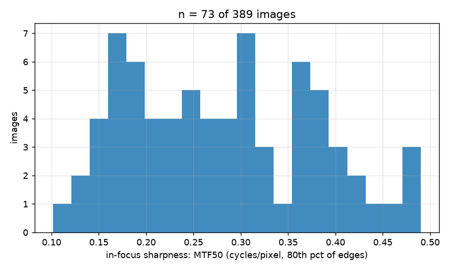
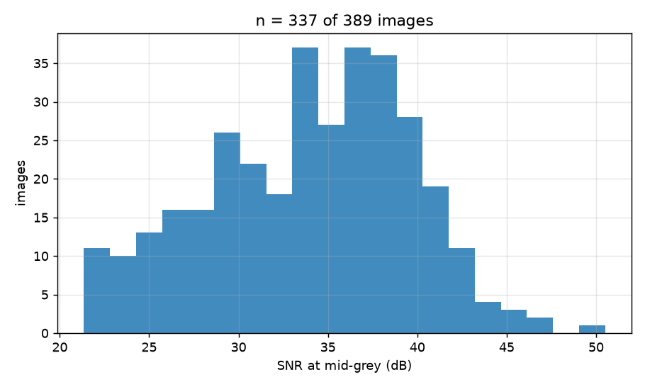
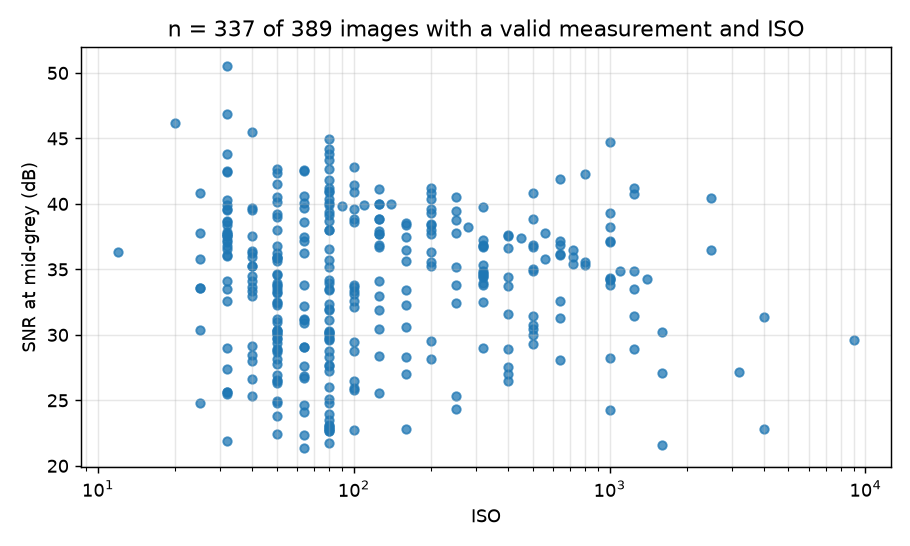
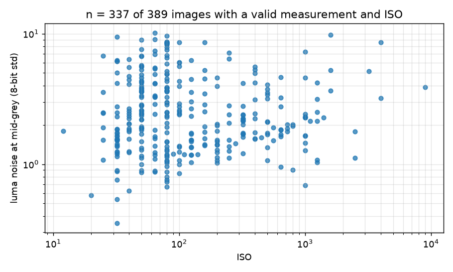
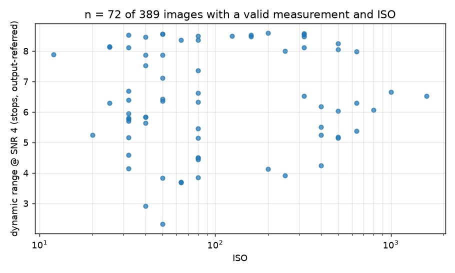
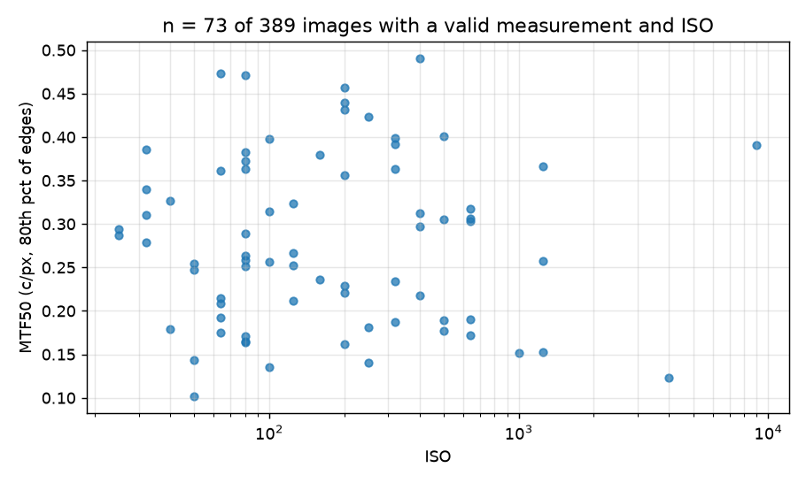
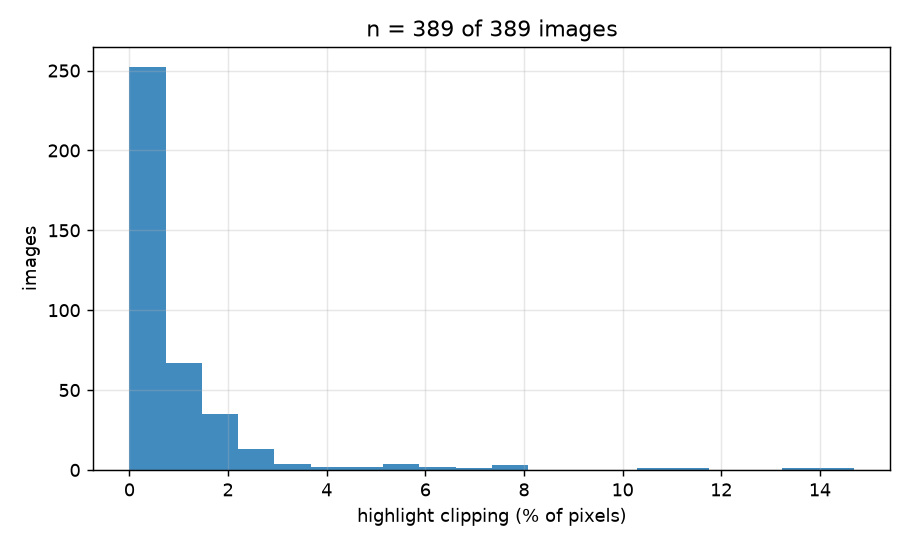
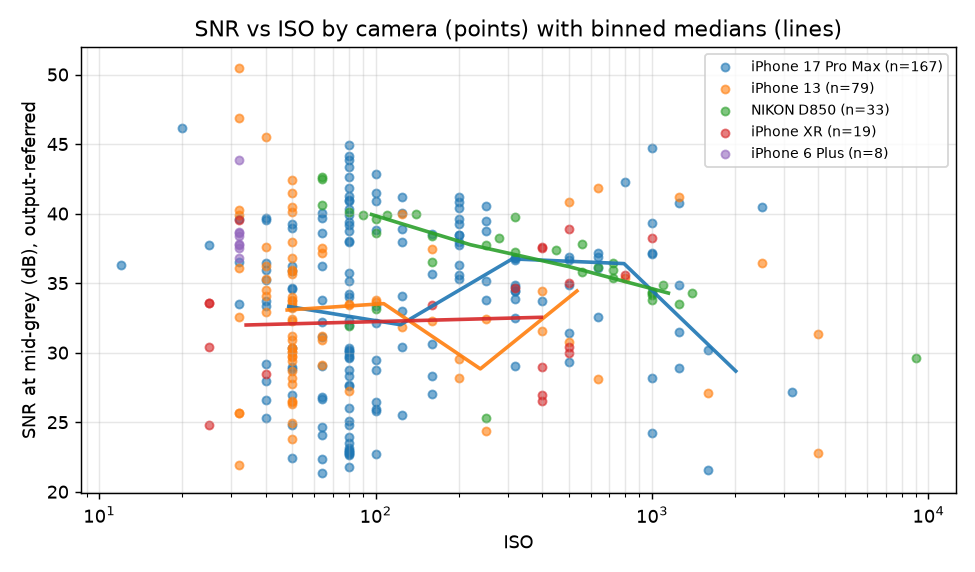
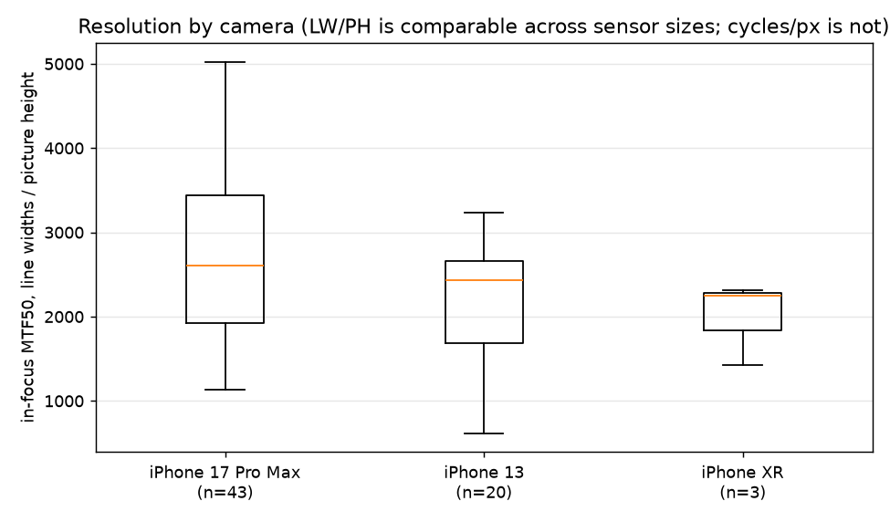
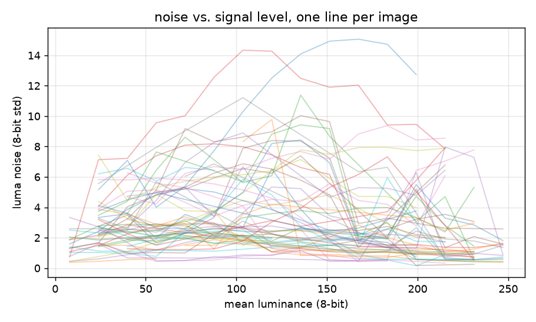

# Allison's Photos library, all 389 camera captures

Generated 2026-10-15 08:38 by iqa on 389 images.

## Summary

| metric | median | min | max | n |
| --- | --- | --- | --- | --- |
| In-focus sharpness, MTF50 (cycles/px) | 0.267 | 0.101 | 0.490 | 73 |
| Overall sharpness, MTF50 (cycles/px) | 0.215 | 0.081 | 0.478 | 73 |
| Centre-of-frame MTF50 (cycles/px) | 0.282 | 0.063 | 0.497 | 48 |
| Outer-frame MTF50 (cycles/px) | 0.179 | 0.070 | 0.447 | 50 |
| Edge overshoot / sharpening halo (% of step) | 12.0 | 0.0 | 60.9 | 73 |
| Edge 10-90 % rise (px) | 2.14 | 0.74 | 6.96 | 73 |
| SNR at mid-grey (dB) | 34.5 | 21.3 | 50.5 | 337 |
| Luma noise at mid-grey (8-bit std) | 2.23 | 0.35 | 10.11 | 337 |
| Chroma noise at mid-grey (8-bit std) | 0.54 | 0.00 | 2.09 | 337 |
| Dynamic range @ SNR 4 (stops, output-referred) | 6.3 | 2.3 | 8.6 | 72 |
| Highlight clipping (% pixels) | 0.42 | 0.00 | 14.70 | 389 |
| Shadow clipping (% pixels) | 0.95 | 0.00 | 71.75 | 389 |
| Noise whiteness (0.14 = white; higher = NR / compression) | 0.42 | 0.10 | 0.93 | 389 |
| Colorfulness (Hasler-Suesstrunk) | 38.6 | 6.9 | 129.8 | 389 |

## What was and was not measurable

- Sharpness: usable slanted edges in **149 of 389** images, and **73** had the three or more edges needed for a per-image figure (the medians and rankings use only those). Images without edges (open water, sky, bokeh) have no sharpness figure; 15162 candidate edges across 382 images were rejected as clipped, shaded, too noisy, too small a step, or not a step at all (counts per image in the CSV).
- Noise: **337 of 389** images had flat patches near mid-grey with noise that looks like noise; 25 report the nearest level instead, 27 are flagged as periodic texture or extreme noise reduction (screens, fabric; 6 of them by the spectral detector), and both groups are excluded from the SNR medians and charts; 0 had no usable patches.
- Dynamic range: the noise floor was reached in **72 of 389** images; the other 317 contained no shadows dark enough and give only a lower bound, which is excluded from the DR medians.

## Sharpest images (MTF50, 80th percentile of edges)

| file | MTF50 c/px | camera | ISO |
| --- | --- | --- | --- |
| EC4679B7-7B54-4AC7-A43E-2967E3E3C961.heic | 0.490 | iPhone 13 | 400.0 |
| 22FE6219-5151-4DA5-8E44-C752DADDA40E.heic | 0.473 | iPhone 17 Pro Max | 64.0 |
| AE7F3723-9440-48D9-8AC4-1C81E7526DA7.heic | 0.471 | iPhone 17 Pro Max | 80.0 |
| 170C5494-554C-4C68-86D7-5AA22E0E3AA4.jpeg | 0.457 | iPhone 17 Pro Max | 200.0 |
| C6220E43-6150-4717-A941-87DFFFA014BC.jpeg | 0.440 | iPhone 17 Pro Max | 200.0 |

## Softest images

| file | MTF50 c/px | camera | ISO |
| --- | --- | --- | --- |
| 72B231CE-5F0C-4596-8655-3D78897FEAC6.jpeg | 0.101 | iPhone 13 | 50.0 |
| D4804990-B88E-43A8-A8FD-E016E14797F4.jpeg | 0.123 | iPhone 13 | 4000.0 |
| D8B92595-5A9F-4BE4-B2DE-28B499BE3C91.heic | 0.136 | iPhone 17 Pro Max | 100.0 |
| 8D63AF53-0BCC-4586-846B-6EF6E08D7EEA.jpeg | 0.141 | iPhone 17 Pro Max | 250.0 |
| CB48F935-DEA5-4102-88CD-E60A95D56A4A.jpeg | 0.143 | iPhone 17 Pro Max | 50.0 |

## Cleanest images (SNR at mid-grey)

| file | SNR dB | camera | ISO |
| --- | --- | --- | --- |
| EF4587A3-53F6-4927-B9B9-B119F77EFFA2.heic | 50.5 | iPhone 13 | 32.0 |
| 95118E14-57DD-41D9-BAA6-996FADB12CF3.heic | 46.9 | iPhone 13 | 32.0 |
| CB7266CA-261A-4850-B087-E6F88170AB5E.heic | 46.2 | iPhone 17 Pro Max | 20.0 |
| 1C2D18C7-6EC5-4451-AC21-11BD00896905.jpeg | 45.5 | iPhone 13 | 40.0 |
| 53A53596-6A8F-46CB-9E23-8373F22FDDA7.jpeg | 44.9 | iPhone 17 Pro Max | 80.0 |

## Noisiest images

| file | SNR dB | camera | ISO |
| --- | --- | --- | --- |
| 0C9BD7A9-33B8-4269-8D35-FFB258CB0CA3.jpeg | 21.3 | iPhone 17 Pro Max | 64.0 |
| F8202BF2-F8FF-463C-8F55-4DE51193EC24.jpeg | 21.6 | iPhone 17 Pro Max | 1600.0 |
| 0F01875A-6B06-4A69-8391-7B95C28EC827.heic | 21.8 | iPhone 17 Pro Max | 80.0 |
| F1E95723-8568-4DC7-AC8C-4875B0E686D8.jpeg | 21.9 | iPhone 13 | 32.0 |
| 6C27D938-35EB-41B1-AA36-BB28C8AA3880.jpeg | 22.3 | iPhone 17 Pro Max | 64.0 |

## Most highlight clipping

| file | % clipped | camera | ISO |
| --- | --- | --- | --- |
| 6721B8DA-E5D3-4B54-B807-8DB95C9B4FCE.jpeg | 14.70 | iPhone 17 Pro Max | 125.0 |
| 61B631F3-5D0C-4575-9B65-BD40EC2A965E.jpeg | 13.92 | NIKON D850 | 64.0 |
| 3A5C53B6-FDA8-405C-AEDF-3A724FBEDC4B.jpeg | 11.33 | iPhone 17 Pro Max | 125.0 |
| 9BD2881A-566B-4598-A89B-4C0F1C6B5A96.jpeg | 10.97 | NIKON D850 | 80.0 |
| 70B6E13D-95FA-49AF-B627-92271E78D577.jpeg | 7.59 | iPhone 4S | 50.0 |

## By camera

| camera | images | MTF50 p80 median (n) | SNR mid-grey dB median (n) | DR@SNR4 stops median (n) |
| --- | --- | --- | --- | --- |
| iPhone 17 Pro Max | 206 | 0.252 (43) | 34.5 (167) | 7.2 (36) |
| iPhone 13 | 85 | 0.308 (20) | 33.0 (79) | 6.4 (17) |
| NIKON D850 | 36 | 0.391 (1) | 36.5 (33) | 3.9 (1) |
| iPhone XR | 21 | 0.279 (3) | 33.6 (19) | 5.8 (10) |
| iPhone 6 Plus | 8 | - (0) | 38.1 (8) | 6.6 (2) |
| iPhone 12 mini | 8 | 0.208 (1) | 31.6 (8) | 5.7 (3) |
| iPhone 6 | 6 | - (0) | 37.1 (4) | - (0) |
| SEALIFE DC2000 | 5 | - (0) | 37.7 (5) | - (0) |
| iPhone 13 mini | 2 | - (0) | 35.5 (2) | - (0) |
| iPhone 17 Pro | 2 | 0.313 (1) | 32.1 (2) | - (0) |
| iPhone SE | 2 | 0.294 (1) | 38.3 (2) | - (0) |
| Canon PowerShot D20 | 1 | - (0) | 32.6 (1) | - (0) |
| iPhone 14 | 1 | - (0) | 33.9 (1) | 8.6 (1) |
| iPhone 12 | 1 | 0.399 (1) | 35.4 (1) | 8.1 (1) |
| iPhone 4S | 1 | - (0) | 32.5 (1) | - (0) |
| iPhone 4 | 1 | - (0) | 22.8 (1) | - (0) |
| iPhone XS | 1 | 0.306 (1) | 31.3 (1) | 6.3 (1) |
| iPhone 15 Pro | 1 | - (0) | 31.2 (1) | - (0) |
| Canon PowerShot G7 X Mark III | 1 | 0.218 (1) | 36.6 (1) | - (0) |

## Charts

## How to read these numbers

- **MTF50** is the spatial frequency (cycles per pixel, along the edge normal) at which contrast falls to 50 %. Higher is sharper; 0.25-0.35 is very sharp (often sharpened), 0.10-0.15 is soft. Measured on natural slanted edges with the ISO 12233 e-SFR method: a real edge is never a perfect step, so every figure is a scene-dependent *lower bound* on the system MTF, consistent across images of similar subjects but not a chart-grade absolute. The 'sharpest images' ranking compares scenes as much as lenses.
- **In-focus sharpness (p80)** assumes at least a fifth of the measured edges are in the plane of focus; on a shallow-depth-of-field frame with few in-focus edges it reports the background. Check `edges_measured` and `mtf50_max_cpp`. `mtf50_*_ci_lo/hi_cpp` are 95 % percentile-bootstrap intervals over the measured edges: how far the figure would move with a different handful of edges from the same frame. With few edges they are wide and reach the sample's extremes; they do not include the scene-dependent bias of natural edges.
- **Structure** columns describe the frame, not its quality: `structure_focus_fraction` is the share of a 4x6 grid holding at least half the frame's peak fine detail (small = a subject against a smooth or blurred field), `structure_focus_cx/cy` is where that detail sits (0-1), `structure_thirds_distance` its distance from the nearest rule-of-thirds point (0 on the point, 1 at the frame centre), the `structure_orient_*` shares say whether strong gradients run horizontally, vertically or diagonally, `structure_horizon_tilt_deg` is the tilt of the longest near-level edge when one exists (a horizon, a table, a shelf; positive = right end lower), and the flat/texture/edge shares say what the surface is made of. `mtf50_infocus_cpp` / `mtf50_background_cpp` appear when the measured edges split cleanly into a sharp and a soft group (a shallow-depth-of-field frame), with `infocus_edge_share` the sharp share; the p80 figure should then be read as the in-focus value.
- **Overshoot** is how far the edge profile overshoots its bright plateau, in % of the step: a direct measure of sharpening halo. MTF50P (relative to the MTF peak) is the sharpening-robust companion of MTF50.
- **SNR at mid-grey** is 20·log10(118 / noise std) on the 8-bit luminance of flat patches; 35+ dB is clean, below 25 dB is visibly noisy. 8-bit quantisation alone caps it at about 52 dB. The figure is output-referred: noise reduction and JPEG/HEIC compression lower it as much as the sensor does, so SNR-vs-ISO across formats is partly a chart of processing. `noise_whiteness` near 0.14 means white noise; 0.3+ means the noise has been smoothed by NR or compression. `noise_spectral_peak` is how far the strongest frequency in the averaged patch spectrum stands above its surroundings: about 1 for noise, above 8 (`noise_periodic_suspect`) the flat patches contain a repeating pattern (a screen's pixel grid, a weave, halftone) at `noise_periodic_freq_cpp` cycles per pixel, and the SNR is of the pattern, not the sensor.
- **Dynamic range** is output-referred: the stops between near-white and the darkest level whose scene-linear SNR still exceeds the threshold. A JPEG's tone curve bounds it, and the floor can only be found in frames that contain near-black flat areas; 'lower bound' rows are excluded from the medians.
- **Clipping** is the share of pixels at the top (any channel >= 254) or bottom (all channels <= 1) of the range, measured in the file's own encoding before any profile conversion. `clip_gamut_pct` is the extra share that saturates only after converting Display P3 or Adobe RGB to sRGB: colour outside the sRGB gamut, not lost detail.
- **White balance** is the gray-world ratio of linear channel means (and in stops); it describes the scene's cast as rendered, which for sunsets and underwater work is intent, not error.
