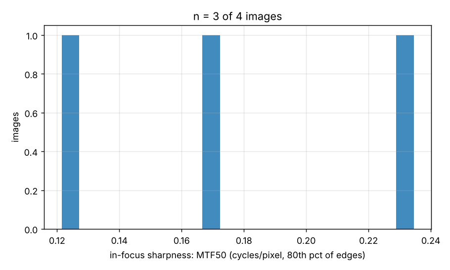
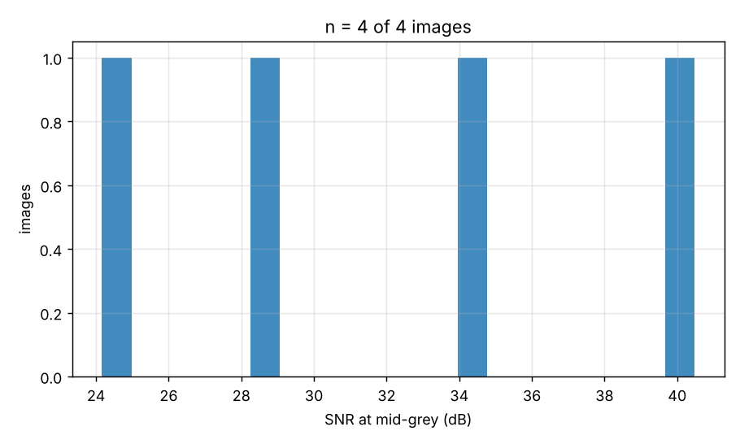
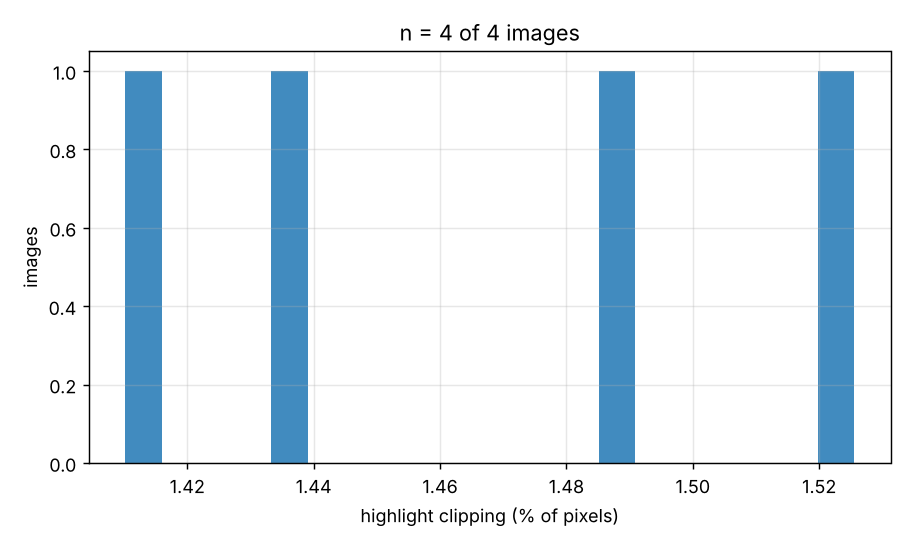
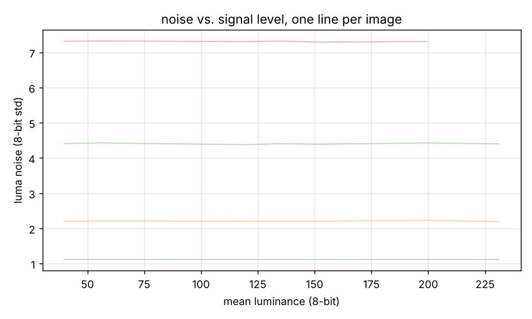

# iqa demo on synthetic scenes

Generated 2026-10-13 02:27 by iqa on 4 images.

## Summary

| metric | median | min | max | n |
| --- | --- | --- | --- | --- |
| In-focus sharpness, MTF50 (cycles/px) | 0.171 | 0.121 | 0.235 | 3 |
| Overall sharpness, MTF50 (cycles/px) | 0.170 | 0.120 | 0.233 | 3 |
| Centre-of-frame MTF50 (cycles/px) | 0.165 | 0.118 | 0.232 | 3 |
| Outer-frame MTF50 (cycles/px) | 0.199 | 0.164 | 0.234 | 2 |
| Edge overshoot / sharpening halo (% of step) | 0.6 | 0.2 | 1.7 | 3 |
| Edge 10-90 % rise (px) | 2.69 | 2.16 | 4.07 | 3 |
| SNR at mid-grey (dB) | 31.6 | 24.2 | 40.5 | 4 |
| Luma noise at mid-grey (8-bit std) | 3.29 | 1.12 | 7.31 | 4 |
| Chroma noise at mid-grey (8-bit std) | 6.24 | 2.12 | 13.87 | 4 |
| Dynamic range @ SNR 4 (stops, output-referred) | 4.6 | 4.6 | 4.6 | 1 |
| Highlight clipping (% pixels) | 1.46 | 1.41 | 1.53 | 4 |
| Shadow clipping (% pixels) | 0.42 | 0.26 | 0.92 | 4 |
| Noise whiteness (0.14 = white; higher = NR / compression) | 0.12 | 0.12 | 0.12 | 4 |
| Colorfulness (Hasler-Suesstrunk) | 11.3 | 6.5 | 21.1 | 4 |

## What was and was not measurable

- Sharpness: usable slanted edges in **3 of 4** images. Images without them (open water, sky, bokeh) have no sharpness figure; 5 candidate edges across 2 images were rejected as clipped, shaded, too noisy, or too small a step (counts per image in the CSV).
- Noise: **4 of 4** images had flat patches near mid-grey; 0 report the nearest level instead and are excluded from the SNR medians and charts; 0 had no usable patches.
- Dynamic range: the noise floor was reached in **1 of 4** images; the other 3 contained no shadows dark enough and give only a lower bound, which is excluded from the DR medians.

## Sharpest images (MTF50, 80th percentile of edges)

| file | MTF50 c/px | camera | ISO |
| --- | --- | --- | --- |
| scene_sigma0.8_noise1.5.png | 0.235 |  |  |
| scene_sigma1.1_noise3.0.png | 0.171 |  |  |
| scene_sigma1.6_noise6.0.png | 0.121 |  |  |

## Softest images

| file | MTF50 c/px | camera | ISO |
| --- | --- | --- | --- |
| scene_sigma1.6_noise6.0.png | 0.121 |  |  |
| scene_sigma1.1_noise3.0.png | 0.171 |  |  |
| scene_sigma0.8_noise1.5.png | 0.235 |  |  |

## Cleanest images (SNR at mid-grey)

| file | SNR dB | camera | ISO |
| --- | --- | --- | --- |
| scene_sigma0.8_noise1.5.png | 40.5 |  |  |
| scene_sigma1.1_noise3.0.png | 34.6 |  |  |
| scene_sigma1.6_noise6.0.png | 28.6 |  |  |
| scene_sigma2.4_noise10.0.png | 24.2 |  |  |

## Noisiest images

| file | SNR dB | camera | ISO |
| --- | --- | --- | --- |
| scene_sigma2.4_noise10.0.png | 24.2 |  |  |
| scene_sigma1.6_noise6.0.png | 28.6 |  |  |
| scene_sigma1.1_noise3.0.png | 34.6 |  |  |
| scene_sigma0.8_noise1.5.png | 40.5 |  |  |

## Most highlight clipping

| file | % clipped | camera | ISO |
| --- | --- | --- | --- |
| scene_sigma0.8_noise1.5.png | 1.53 |  |  |
| scene_sigma1.1_noise3.0.png | 1.49 |  |  |
| scene_sigma1.6_noise6.0.png | 1.44 |  |  |
| scene_sigma2.4_noise10.0.png | 1.41 |  |  |

## Charts

## How to read these numbers

- **MTF50** is the spatial frequency (cycles per pixel, along the edge normal) at which contrast falls to 50 %. Higher is sharper; 0.25-0.35 is very sharp (often sharpened), 0.10-0.15 is soft. Measured on natural slanted edges with the ISO 12233 e-SFR method: a real edge is never a perfect step, so every figure is a scene-dependent *lower bound* on the system MTF, consistent across images of similar subjects but not a chart-grade absolute. The 'sharpest images' ranking compares scenes as much as lenses.
- **In-focus sharpness (p80)** assumes at least a fifth of the measured edges are in the plane of focus; on a shallow-depth-of-field frame with few in-focus edges it reports the background. Check `edges_measured` and `mtf50_max_cpp`.
- **Overshoot** is how far the edge profile overshoots its bright plateau, in % of the step: a direct measure of sharpening halo. MTF50P (relative to the MTF peak) is the sharpening-robust companion of MTF50.
- **SNR at mid-grey** is 20·log10(118 / noise std) on the 8-bit luminance of flat patches; 35+ dB is clean, below 25 dB is visibly noisy. 8-bit quantisation alone caps it at about 52 dB. The figure is output-referred: noise reduction and JPEG/HEIC compression lower it as much as the sensor does, so SNR-vs-ISO across formats is partly a chart of processing. `noise_whiteness` near 0.14 means white noise; 0.3+ means the noise has been smoothed by NR or compression.
- **Dynamic range** is output-referred: the stops between near-white and the darkest level whose scene-linear SNR still exceeds the threshold. A JPEG's tone curve bounds it, and the floor can only be found in frames that contain near-black flat areas; 'lower bound' rows are excluded from the medians.
- **Clipping** is the share of pixels at the top (any channel >= 254) or bottom (all channels <= 1) of the range.
- **White balance** is the gray-world ratio of linear channel means (and in stops); it describes the scene's cast as rendered, which for sunsets and underwater work is intent, not error.
